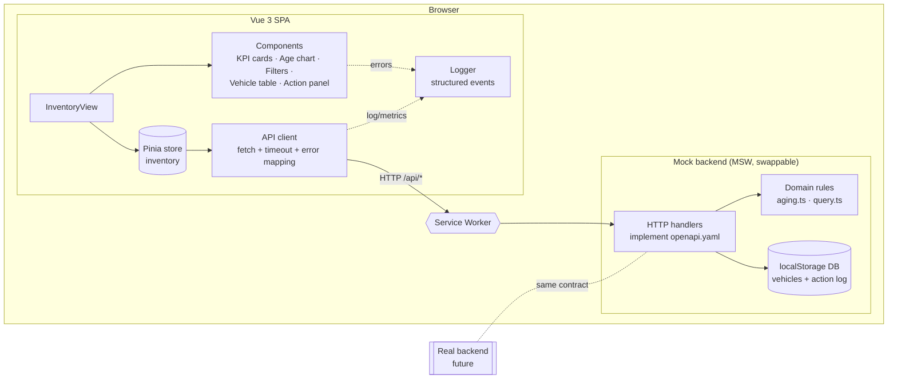
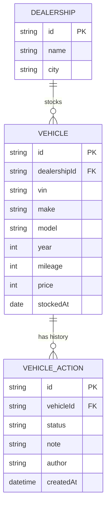
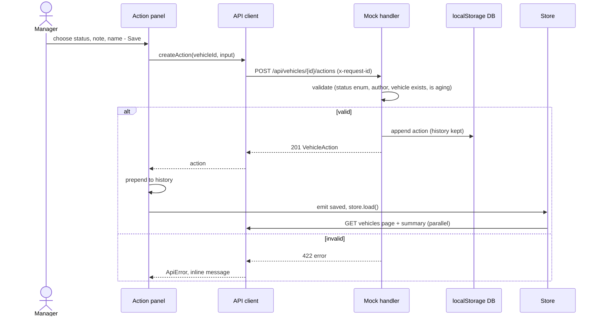

# System Design — Intelligent Inventory Dashboard (Scenario B)

**Scope:** Frontend implemented in full (Vue 3 + TypeScript). The backend is mocked with Mock Service Worker (MSW) and follows a written contract ([`openapi.yaml`](./openapi.yaml)). A real service can replace the mock without changes to the UI.

## 1. Problem and assumptions

Dealership managers need a live overview of their vehicle stock. They also need to find vehicles that have been on the lot too long ("aging stock") and record what they plan to do about each one.

The brief is ambiguous in places. These are the assumptions this design makes:

| # | Assumption | Why |
|---|------------|-----|
| A1 | **Days in stock** = whole calendar days from the date the vehicle arrived at the dealership (`stockedAt`, a date without time) to today, using UTC dates. A vehicle that arrived today has 0 days. | Stock dates are business dates. Using UTC dates avoids off-by-one errors around midnight and daylight-saving changes. |
| A2 | **Aging stock** = days in stock **> 90**, so day 90 is not aging and day 91 is. | This is the literal reading of "in inventory for >90 days". |
| A3 | A `stockedAt` in the future or not a valid date is a **data-quality issue**. The vehicle is still listed, flagged "Data issue", and kept out of age filters and aging KPIs. | One bad record must not crash the dashboard or skew its numbers. |
| A4 | Each screen shows **one dealership**, picked from a selector. A manager may look after several sites. | The brief says "a dealership's inventory". |
| A5 | The age filter uses fixed bands: 0–30, 31–60, 61–90 and 90+ days. | Bands are quicker to use than a numeric range, and they match the age chart. |
| A6 | Actions can be logged **only for aging vehicles**, and every entry is **kept as history** (append-only). The status shown is the latest entry. | The brief says "for each aging vehicle". Keeping history shows who decided what and when. |
| A7 | Users are dealership managers who are already signed in. Authentication is out of scope, and the author of an action is a free-text name. | Identity belongs to the platform, not to this feature. |
| A8 | "Real-time" means the data is fresh when you open the screen and refreshes after each change. Pushing live updates is listed as future work (§8). | It covers what the brief needs without building infrastructure the mock cannot exercise. |

## 2. Architecture

### Components and their roles

| Component | Role |
|-----------|------|
| **InventoryView** | The page. It holds the dealership selector, tabs (All stock / Aging stock) and layout. |
| **KPI cards** | Total vehicles, aging vehicles, aging rate, and aging vehicles that have no action yet. |
| **Age chart** | Vehicle counts per age band. Clicking a band applies it as a filter. |
| **Filter bar** | Make, model (limited to the chosen make), age band and VIN/model search. Filters are applied on the server. |
| **Vehicle table** | Paged list with an aging badge, days in stock, latest action and a suggested next step. |
| **Action panel** | Shows the full action history for one vehicle and a form to add a new entry. |
| **Pinia store** | Single source of truth for filters, pages, loaded data and the `idle/loading/ready/error` state. |
| **API client** | Typed `fetch` wrapper. It adds a timeout and an `x-request-id`, measures latency, and turns HTTP or network failures into one `ApiError` type. |
| **Domain rules** (`src/domain`) | Pure functions with no framework code: days in stock, aging check, age band, suggested action, query and filtering. The mock server uses them, and a real backend would follow the same rules. |
| **MSW handlers** | Implement the REST contract inside a Service Worker, add realistic latency, and can inject failures (`?mock=error`, `?mock=slow`). |
| **localStorage DB** | Stores the seeded vehicles and the append-only action log, so logged actions survive a page reload. |
| **Logger** | Central structured logging for API calls, Vue errors and unhandled rejections (§6). |

## 3. Data model

The action `status` is one of `PRICE_REDUCTION_PLANNED`, `PROMOTION_PLANNED`, `TRANSFER_REQUESTED`, `SENT_TO_AUCTION`, `UNDER_REVIEW` or `SOLD`.
The server computes `daysInStock`, `isAging`, `ageBand`, `latestAction` and `suggestedAction` and adds them to the vehicle response. The client never works out business rules on its own.

## 4. Data flow

**Viewing and filtering**
1. The user picks a dealership or changes a filter. The store updates its filters, resets to page 1 and calls `GET /api/dealerships/{id}/vehicles?make=&model=&ageBand=&agingOnly=&q=&page=&pageSize=`.
2. The handler loads the dealership's vehicles, enriches each one with the domain rules, filters, sorts by days in stock (oldest first) and returns one page plus facet lists (makes and models) and the total count.
3. In parallel, `GET /api/dealerships/{id}/summary` returns the KPI and age-band counts.
4. The store keeps track of the most recent request, so a slow, outdated response cannot overwrite a newer one.

**Logging an action**

## 5. Technology choices

| Technology | Why |
|------------|-----|
| **Vue 3 + `<script setup>` + TypeScript** | Composition API, typed props and emits, and a small runtime. TypeScript types mirror the OpenAPI schema. |
| **Vite** | Fast development server and build, with native ESM. |
| **Pinia** | Official Vue store with typed state and simple testing. One store is enough for one screen. |
| **MSW** | Mocks at the network layer, so the app makes real `fetch` calls. Switching to a real backend means turning off the mock, with no code changes. The same handlers can run in tests. |
| **Hand-written CSS** (custom properties) | No UI framework to justify. The table, chart and panel are small, and the page can be themed in light and dark mode. |
| **Vitest + Vue Test Utils** | Unit tests for the domain rules and component tests, running on the same Vite pipeline. |
| **Playwright** | End-to-end tests of the main user journeys in a real browser, including persistence across reloads. |
| **OpenAPI 3.1** | Written contract for the backend team. It documents server-side filtering and paging so the mock and a future service cannot drift apart. |
| **Vercel** | Static hosting with a public demo URL. |

## 6. Observability strategy

**Implemented in the frontend**
- **Structured logs:** `logger.ts` writes JSON-shaped events (`level`, `event`, `requestId`, `durationMs`, context). Development builds log to the console, and recent events are kept in a ring buffer that can be inspected as `window.__appLogs`.
- **Request correlation:** every API call sends an `x-request-id`. The same id appears in client logs and would appear in server logs.
- **Metrics:** latency and status of each API call are recorded as `api.request` events.
- **Error capture:** `app.config.errorHandler`, `window.onerror` and `unhandledrejection` all go to the logger. Users see a friendly error state with a retry button, not a blank page.

**Production plan**
- Send the logger's output to an OpenTelemetry Web SDK exporter (or Sentry) so frontend spans join backend traces through W3C `traceparent`.
- Real user monitoring: Core Web Vitals (LCP, INP, CLS) per route.
- Track API error rate and p95 latency per endpoint, and alert when the error rate stays above 2% for 5 minutes.
- Product metric: the share of aging vehicles that have an action logged within 7 days.

## 7. Non-functional considerations

- **Scalability:** filtering, sorting and paging run on the server (contract §4), so the client only ever holds one page (25 rows). Summary counts come from a separate endpoint that a backend could cache or precompute.
- **Performance:** search input is debounced, outdated responses are ignored, and requests run in parallel.
- **Reliability:** request timeouts, one error type, retry from the error state, and records with bad dates are flagged instead of breaking the page.
- **Maintainability:** business rules are pure functions with exhaustive tests and live outside UI components. The mock is isolated in `src/mocks`, so removing it is a one-line change.
- **Accessibility:** semantic table markup, labelled form controls, a focus-managed dialog, and colour paired with text for the aging badge.

## 8. Future work

- Live updates over SSE or WebSocket when another manager logs an action.
- Authentication with role-based access, using the signed-in user as the action author.
- Sorting and column choices kept in the URL, CSV export, and suggested actions based on sales velocity and market price data.

## 9. How GenAI was used in the design phase

The design was produced with **Claude Code** (Claude Opus 5.5). I set the direction, and the AI did the analysis and drafting.

1. **Choosing the scenario.** I used an AI assistant to compare the four scenarios against my strengths (Vue, dashboards). We picked B and listed what would add depth to a lighter scenario: a written API contract, test-first domain rules, three test layers and an action *history* instead of a single status.
2. **Reading the requirements.** The agent read the brief and pointed out requirements that are easy to miss: age is a *required* filter, the System Design Document needs six specific sections, the video has five required parts, and the brief says AI verification is the "primary evaluation criterion".
3. **Clarifying instead of guessing.** I told the agent to ask rather than assume. It asked four questions (repo visibility, hosting, CSS approach, document format) and proposed assumptions for the rest. I accepted or adjusted each one, and they became table §1 (A1–A8).
4. **Contract before code.** The AI drafted this document and `openapi.yaml` before any UI existed, so the UI was built against the contract. A linter (`redocly lint`) was then run on the spec. It found two real errors, where unquoted descriptions containing commas broke the YAML structure, plus missing security and 4xx definitions. These were fixed, so the contract is not just AI text that has never been checked.
5. **Design checks.** I used a UI/UX design-guidance tool for the visual direction ("data-dense dashboard": blue data colour and an amber accent for aging stock). I rejected its suggested *landing-page* layout (hero section, client logos, "Contact Sales") because it does not fit an internal tool.

What I owned: the scope, the assumptions, the business rules (the >90-day boundary, the suggestion tiers, and that only aging vehicles can have actions) and the decision to keep filtering on the server for scalability.
